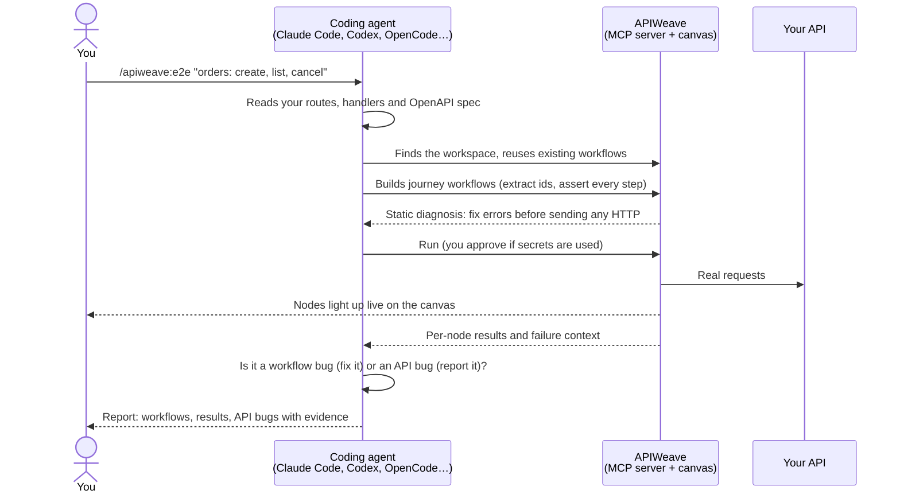

<div align="center">

# APIWeave

**End-to-end API tests your coding agent can build, run and debug, on a canvas you can see.**

[](https://github.com/Kaysharp42/apiweave/releases/latest)
[](LICENSE)


[Install](#install) · [Connect your agents](#connect-your-coding-agents) · [`/apiweave:e2e`](#test-with-one-command-apiweavee2e) · [Docs](docs/README.md) · [Changelog](CHANGELOG.md)

</div>

---

Your coding agent just wrote an endpoint. Does it work? Does the whole journey work: sign up, log in, create an order, read it back, delete it, and get a 404 afterwards?

APIWeave answers that. It is a local-first desktop app where API tests are **workflows on a visual canvas**: requests, assertions, extracted variables and branches you can see. It ships an **MCP server** that Claude Code, Codex, OpenCode, Cursor, VS Code and Claude Desktop connect to in one click. Type `/apiweave:e2e "checkout flow"` in your agent. It reads your code, builds the workflows, runs them against your environment and fixes its own mistakes. It reports the real API bugs it finds, with evidence. You watch the nodes light up on the canvas while it works.

No cloud account. No server to deploy. No test scripts to maintain. Everything stays on your machine.

## Why APIWeave

- **AI-native E2E testing.** One slash command takes an agent from "test the invoice API" to tested user journeys, with assertions after every request and negative cases included.
- **You can see what the agent built.** Agent-written tests are a graph on a canvas, not 400 lines of generated test code. Agent runs animate live, and every agent edit is a version you can undo.
- **It keeps agents honest.** The `/apiweave:e2e` prompt tells the agent to separate a broken test from a broken API, and never to weaken an assertion to turn a run green. Static diagnosis catches graph mistakes before any HTTP is sent.
- **Secrets stay secret.** Agents see secret *names*, never values. A run an agent starts that would use a secret waits for your approval in a native dialog, and can reach only the hosts the dialog lists.
- **It also helps your coding agent.** While it builds features, your agent has a real test harness it can drive: reuse existing workflows, rerun only the failed branch, read one node's response, and confirm the fix, without leaving the conversation.
- **From canvas to CI.** Track a workspace in git and run it in any pipeline with `apiweave run`, with JUnit and HTML reports and exit codes that fail the build.
- **Local-first.** One self-contained app with an embedded SQLite store. The MCP bridge listens only on `127.0.0.1`, behind a per-install token. No telemetry.

## How It Works



## Install

Download the installer for your OS from the **[latest release](https://github.com/Kaysharp42/apiweave/releases/latest)**. No Python, Node.js, database or Docker is needed to run the app.

| Platform | Download | Notes |
| --- | --- | --- |
| **Windows 10/11** (x64) | `APIWeave-<version>-win-x64.zip` | Extract the zip and run the `.exe` inside. Installs per-user with no admin prompt. An `.msi` is published too, for Intune and Group Policy. The bare `.exe` on the release is the in-app updater's download. |
| **macOS 13+** | `mac-arm64.dmg` (Apple Silicon) or `mac-x64.dmg` (Intel) | Drag APIWeave to Applications. |
| **Linux** (x64, glibc 2.34+) | `.AppImage`, `.deb`, `.rpm`, `.pacman` | See the commands below. |

```bash
# Linux: pick the package for your distro
sudo apt install ./APIWeave-<version>-linux-amd64.deb       # Debian, Ubuntu, Mint
sudo dnf install ./APIWeave-<version>-linux-x86_64.rpm      # Fedora, RHEL, openSUSE
sudo pacman -U APIWeave-<version>-linux-x64.pacman          # Arch, Manjaro
chmod +x APIWeave-<version>-linux-x86_64.AppImage && ./APIWeave-<version>-linux-x86_64.AppImage   # any distro
```

> [!NOTE]
> **The 1.0 installers are not code-signed.** On Windows, SmartScreen may warn on first launch: choose **More info → Run anyway**. On macOS, right-click the app and choose **Open**, or run `xattr -dr com.apple.quarantine /Applications/APIWeave.app`. Every update is still verified against the signing key built into the app before it installs. Windows and the AppImage update in place; macOS and the Linux packages show a notice linking to the new version.

The AppImage needs FUSE 2 (`sudo pacman -S fuse2` on Arch), or run it with `--appimage-extract-and-run`. On Arch, prefer the `.pacman` package. The app runs natively on Wayland, Hyprland included. The full guide, with first-launch details and troubleshooting, is [Installation](docs/getting-started/installation.md).

## Connect Your Coding Agents

To connect your agents, you turn on one setting and click **Connect**. You edit no config files.

1. Open APIWeave and go to **Settings → MCP Server**.
2. Turn on **Enable local MCP server**.
3. Under **Connect your agents**, click **Connect all**, or **Connect** next to each client you use.
4. Restart the agent.

| Client | What **Connect** does |
| --- | --- |
| **Claude Code** | Runs `claude mcp add --scope user apiweave …` |
| **Codex** | Runs `codex mcp add apiweave …` |
| **OpenCode** | Adds `mcp.apiweave` to your global `opencode.json(c)` |
| **Cursor** | Adds `mcpServers.apiweave` to `~/.cursor/mcp.json` |
| **VS Code** | Adds `servers.apiweave` to your user `mcp.json` |
| **Claude Desktop** | Adds `mcpServers.apiweave` to `claude_desktop_config.json` (the Microsoft Store install's copy too) |

How the connection behaves:

- **Your agents can reach APIWeave even when the app is closed.** Each client runs a small stdio launcher. It answers at once and starts APIWeave hidden in the tray when a tool is needed, so starting your agent before APIWeave is fine.
- **APIWeave writes only the `apiweave` entry, and only when you click.** Comments, formatting and your other servers are left as they are. **Disconnect** removes the entry.
- **It needs Node.js 20 or newer** on your machine, because the launcher runs with your own `node`. The settings page tells you if it is missing.
- **The status of each client is shown**: Connected, Old entry (click **Replace**), Not connected, or Not found.

**Using another MCP client** (Gemini CLI, Copilot CLI, Windsurf, …)? Point it at the launcher. Copy the exact path from **Settings → MCP Server**:

```json
{
  "mcpServers": {
    "apiweave": {
      "command": "node",
      "args": ["/home/you/.config/APIWeave/apiweave-mcp.cjs"]
    }
  }
}
```

The launcher lives in `%APPDATA%\APIWeave\` on Windows, `~/Library/Application Support/APIWeave/` on macOS and `~/.config/APIWeave/` on Linux. A direct HTTP config (`http://127.0.0.1:47271/mcp` with a bearer token) is also available. Recipes for every client are in [MCP Integration](docs/features/mcp-integration.md#client-configuration).

### Or launch the agent inside APIWeave

Open a workflow, click **Set folder** in the canvas toolbar and pick your API's source folder. Then click the agent button. Your agent opens in a dock beside the canvas, already connected to the MCP server and told which workflow, project and workspace it is working on. Ten agents are built in: Claude Code, Codex CLI, Gemini CLI, OpenCode, Cursor Agent, Aider, GitHub Copilot CLI, Qwen Code, Crush and Pi. You can add any other CLI. Most of them can resume a session later. See [Coding Agents](docs/features/coding-agents.md).

## Test With One Command: `/apiweave:e2e`

APIWeave publishes MCP prompts, which agents that support them show as slash commands. The main one is:

```text
/apiweave:e2e "what to test"
```

> [!IMPORTANT]
> **Quote the task.** Claude Code and OpenCode pass only the first word to the command otherwise.

Examples:

```text
/apiweave:e2e "signup, login and password reset"
/apiweave:e2e "orders API: create, list with filters, cancel, and the error cases"
/apiweave:e2e "the endpoints I changed on this branch"
/apiweave:e2e "run the existing tests and fix what broke"
/apiweave:e2e
```

With no task, the agent asks what to test and suggests something based on your workspace and repository.

What the agent then does:

1. **Finds the scope.** It picks the workspace and project that match your repository, or the ones APIWeave launched it on. It reuses existing workflows and copies their base URL, auth and variable conventions.
2. **Learns the real API.** It reads your routes, handlers, validation and OpenAPI spec, so it tests what the code promises instead of guessing.
3. **Designs user journeys, not isolated calls.** It authenticates once and reuses the token. It creates, reads back, updates, lists and deletes, extracting ids from responses. It adds an assertion after every request, negative cases (invalid input, not found, unauthorized), and unique test data such as `{{uuid()}}`, so reruns do not collide.
4. **Diagnoses before running.** Every write returns a static diagnosis, which is free and sends no HTTP. The agent clears the errors before any real request goes out.
5. **Runs safely.** It says which environment and base URL it will hit, and asks first if that looks like production. Runs that use secrets wait for your approval.
6. **Debugs honestly.** On a failure it reads the failure context and the evidence. It fixes the workflow when the workflow is wrong. When the API is wrong, it keeps the failing assertion and reports the bug.
7. **Reports.** It lists the workflows created or changed, what each covers, the last run results, the API bugs found with evidence, and anything you still need to do, such as add a missing secret.

| Command | What it does |
| --- | --- |
| `/apiweave:e2e "task"` | Find or build, run, debug and report end-to-end API tests. |
| `/apiweave:author_assertions` | Turn plain language ("it should return 200 and a token within 500 ms") into validated assertion rules. The agent shows a preview, then applies the rules after you approve. |

**Codex doesn't show MCP prompts**, and some other clients don't either. There you can just ask: *"Use APIWeave to test the checkout flow end to end."* Every connected agent receives APIWeave's instructions when it connects, so it knows how to work with the tools.

### What else your agent can do

Beyond the slash commands, a connected agent has the whole workspace at its disposal through the MCP tools:

- Map a workspace: which workflows call which endpoints, and which variables, environments and secrets they use.
- Find every node that calls `/orders` or uses `{{secrets.API_KEY}}`, across all workflows.
- Patch a workflow in place under a revision guard, so it never overwrites your unsaved canvas edits.
- Rerun only the failed branch, or start again from one node, reusing the upstream results.
- Read one node's stored request and response, with secrets redacted, to explain a failure.
- Suggest assertions verified against a real response, and run whole projects in order.

The full tool inventory, the guides served to agents and the security model are in [MCP Integration](docs/features/mcp-integration.md).

## Built for Trust

| Concern | How APIWeave handles it |
| --- | --- |
| Network exposure | The MCP bridge is off until you turn it on. It binds to `127.0.0.1` only and requires a per-install token. No webhooks, no remote triggers. |
| Secrets | They are encrypted at rest, with the key sealed by the OS keychain. Agents get names and metadata only. Secrets cannot be created or read over MCP. |
| Agent runs | A run that uses secrets waits for your approval (allow once, for this session, or always). It may reach only the hosts the dialog listed. |
| Agent edits | Every agent write keeps the previous version, so you can undo it. Writes use compare-and-swap against the revision the agent last read. |
| Exports | `.aweproject` bundles and git repositories hold `{{secrets.NAME}}` references, never values. |

## Everything Else in the Box

- **[Workflows and Nodes](docs/features/workflows-and-nodes.md)**: HTTP, SSE, assertion, delay, merge, call-workflow, start and end nodes, with notes and groups on a React Flow canvas.
- **[Variables and Extractors](docs/features/variables-and-extractors.md)**: chain requests with `{{variables.x}}`, `{{env.x}}`, `{{prev.x}}`, `{{secrets.x}}` and [dynamic functions](docs/reference/dynamic-functions.md).
- **[Scripting](docs/features/scripting.md)**: sandboxed pre-request and post-response JavaScript.
- **[Data-Driven Runs](docs/features/data-driven-runs.md)**: run a workflow once per row of a CSV or JSON file.
- **[Visualization and Debugging](docs/features/visualization-and-debugging.md)**: run timeline, variable provenance and camera-follow during runs, plus rerun from any node.
- **[Projects](docs/features/projects.md)**: ordered suites of workflows, with `.aweproject` export and import.
- **[Environments and Secrets](docs/features/environments-and-secrets.md)**: environments that inherit from a base environment, and an encrypted secret store.
- **[Keep Tests in Git](docs/guides/git-workflows.md)**: sync a workspace with GitHub, GitLab or any remote, with built-in sign-in and branches.
- **[Run Tests in CI](docs/guides/ci.md)**: the headless `apiweave run` CLI, with no Electron and no window.
- **[Swagger / OpenAPI Import](docs/features/swagger-import.md)** and **[Postman Import](docs/guides/migrating-from-postman.md)**.
- **[Network](docs/features/network.md)**: proxies, private certificate authorities and client certificates.
- **[Node Presets](docs/features/node-presets.md)**: reusable node configurations across a workspace.

### Run in CI

```bash
curl -fsSL -o apiweave-cli.tgz \
  https://github.com/Kaysharp42/apiweave/releases/latest/download/apiweave-cli.tgz
npm install -g ./apiweave-cli.tgz            # Node.js 22.12+

export APIWEAVE_SECRET_API_TOKEN="$TOKEN"    # secrets come from CI variables
apiweave run ./tests --env Staging --reporter cli,junit
```

Exit code `0` means every test passed, `1` means a test failed and `2` means a usage or configuration error. See [Run Tests in CI](docs/guides/ci.md).

## Documentation

- **[Documentation Hub](docs/README.md)**: start here.
- **[Your First Workflow](docs/getting-started/first-workflow.md)**: a five-minute tour of the canvas.
- **[MCP Integration](docs/features/mcp-integration.md)** and **[Coding Agents](docs/features/coding-agents.md)**: everything about agents.
- **[Compatibility policy](docs/reference/compatibility.md)**: what 1.x keeps stable for MCP tools, workspace repositories, `.aweproject` bundles and the CLI.
- **[Known limitations](docs/reference/known-limitations.md)** and **[Releases and updates](docs/reference/release-and-updates.md)**.

## Build From Source

```bash
git clone https://github.com/Kaysharp42/apiweave.git
cd apiweave
./scripts/setup.sh          # Windows: .\scripts\setup.ps1
cd app && npm run dev       # launch the desktop app in development mode
```

Source builds need Node.js 22.12+. On Linux, `node-pty` compiles a native addon, so you also need `make`, `python3` and a C++ compiler. Build an installer with `scripts/desktop.sh build` (or `scripts/desktop.ps1 build` on Windows). If your global npm config sets `allow-scripts=false`, `scripts/setup.sh` downloads the Electron binary manually.

The stack: Electron 44 with an embedded SQLite store (better-sqlite3), a React 19 + React Flow 12 renderer (Vite, Tailwind CSS 4, Zustand), strict TypeScript, and a typed IPC handler registry that also backs the MCP bridge. See [Architecture](docs/reference/architecture.md).

```text
app/
  src/       React renderer: canvas, contexts, components
  electron/  Electron main process, preload worlds, PTY host
  core/      IPC handlers, repositories, runner, services, MCP bridge, CLI
  shared/    Cross-process TypeScript contracts and Zod schemas
scripts/     setup / start / build (Linux, macOS, Windows)
docs/        User-facing documentation
```

## Contributing

Contributions are welcome. See [CONTRIBUTING.md](CONTRIBUTING.md) for setup, branching, commit style and the pull-request flow, and [AGENTS.md](AGENTS.md) for the developer guide. What's next is in [ROADMAP.md](ROADMAP.md); what has shipped is in [CHANGELOG.md](CHANGELOG.md).

## License

[MIT](LICENSE)
