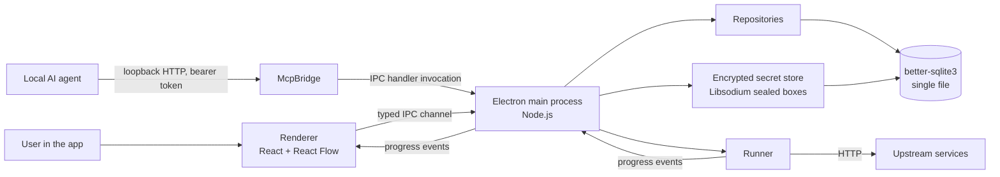

# Architecture

*A high-level overview of how APIWeave's components fit together and how a workflow run moves through the system. This doc is conceptual: no source code references, no class names, just the moving parts.*

## Prerequisites

None. This is a reference doc for users who want to understand the moving parts of APIWeave before diving into feature guides or local MCP setup.

## System Overview

The diagram shows the components that make up APIWeave and the paths a request can take from the user or a local agent to the database and back. The next sections describe each piece in plain language.

## Components

**Renderer** is a React single-page app built on the React Flow canvas library (`@xyflow/react`). It hosts the visual workflow editor, the variables and environments panels, the secrets page, and the project list. The renderer never talks to the database directly; everything flows through the main process over a typed IPC channel exposed by the preload script.

**Main process** is the Electron main process: a single Node.js process that owns the BrowserWindow, the IPC handler registry, the services, the repositories, the runner, the encrypted secret store, and the local MCP bridge. The main process is the only component that touches the database.

**IPC handler registry** is the typed single-channel router that wires the renderer's calls to the services. The same registry backs the local MCP bridge, so behavior is consistent regardless of which transport called it.

**Services** hold all business logic. The renderer and the MCP bridge both go through the services. The services know nothing about transport; they take typed input, return typed output, and write through the repositories.

**Repositories** are the only place that touches better-sqlite3. Every consumer (handlers, services, runner) goes through repository methods. The schema lives in `app/core/db/migrations/`.

**Runner** is the in-process execution engine. The `RunScheduler` claims pending runs, the `WorkflowExecutor` walks the node graph, `safe_http` makes the outbound HTTP calls, and `dynamic_functions` evaluates the placeholder functions. Progress is streamed back to the renderer over IPC as the run advances.

**Script sandbox** (`core/runner/script_sandbox.ts`) runs an HTTP Request node's pre-request and post-response [scripts](../features/scripting.md). The host never evaluates user code itself: nothing the app or its CLI runs calls `eval`, `vm` or `new Function`. (`main.cjs` does contain one `new Function`, in Ajv, which the MCP SDK imports as its default JSON Schema validator; the MCP server is given the SDK's interpreter-based `@cfworker/json-schema` validator instead, so Ajv is never constructed.) A script runs in QuickJS compiled to WebAssembly (`quickjs-emscripten`), a separate engine with its own heap, in a fresh instance per script whose linear memory is capped at 32 MB above QuickJS's own, with an interrupt handler enforcing the script's time limit. Inside it there is no `require`, `process`, network, file system or timer; the only way out is one host function that serves the `aw` API (variables, HMAC/SHA-256, Base64, UUIDs, console output, test results) with strings in and strings out. Node's `vm` module was not used because it is not a security boundary, and `isolated-vm` because it is a V8-ABI native addon, which the app's N-API-only, never-rebuilt rule excludes. The WASM binary is embedded in the variant's JavaScript, so esbuild bundles it with no `.wasm` file to locate. A script is synchronous, so it does not run on the runner's thread — in the app that is the main process, which a `while (true) {}` would freeze until the deadline. `runScript` hands it to a worker thread (`core/runner/script_worker.ts`, built as `script-worker.cjs` beside `main.cjs` and the CLI, and listed in `build.asarUnpack`); cancelling the run terminates the worker, and idle workers are reused because starting one costs ten times a typical script. `aw.crypto.uuid()` still comes from the run's own generator: the worker blocks on a `SharedArrayBuffer` while the caller answers.

**Response validation** backs the `matches`/`notMatches`, `type` and `matchesSchema` [assertion operators](../features/workflows-and-nodes.md#validation-operators) and an HTTP node's [`responseSchemas`](../features/workflows-and-nodes.md#response-schemas). A regular expression comes from the workflow and the text it is tested against from a server, and V8 has no time limit for a regex, so a backtracking pattern could freeze the main process; `core/runner/regex_sandbox.ts` runs each match in a QuickJS instance (the script sandbox's engine and memory cap, one instance per run, a fresh runtime per match) whose regex engine polls the interrupt handler, stopping a match at 100 ms, with the input capped at 100,000 characters. JSON Schemas (`core/runner/json_schema.ts`) are validated by `@cfworker/json-schema`, which interprets the schema as data; Ajv was not used because it compiles every schema into JavaScript with `new Function`, which would turn a schema from a workflow or an imported spec into code the host runs. A validator is compiled once per schema per run.

**Encrypted secret store** is a tightly scoped layer inside the main process. It accepts Libsodium sealed-box submissions on the write path and stores the sealed ciphertext verbatim. At run time it opens the boxes with the key held in the per-install keyfile, which is itself sealed by the OS keychain (Keychain, DPAPI, GNOME Keyring or KWallet) where one is available, resolves the local scope chain (selected environment, then the workspace store), and returns decrypted values only to the runtime that needs them. The masking layer scrubs the value before any persistence. The secret store has no read API for stored values that can be reached by a user. Secret values never sync, even when workflow structure does.

**Local MCP bridge** is an opt-in loopback HTTP server bound to `127.0.0.1`. It exposes the IPC handler registry as a second transport, so local AI agents on the same machine can drive the app. The bridge authenticates with a per-install bearer token that you can regenerate from Settings, and refuses any request whose `Host` is not its own loopback address. A run an agent starts that would send stored secrets waits for your approval in a native dialog. The bridge is off by default; until you enable it, nothing is listening on any port.

**Workflow analysis service** powers `workflow_diagnose`: a deterministic, value-free pass over the node graph that reports topology, reachability, assertion wiring, and extractor findings, and correlates run evidence when a run id is supplied.

**Assertion authoring service** backs the suggest/validate/apply assertion tools used by the assertion editor and by MCP agents.

**Run event broker** is the process-local fan-out for run transitions: every run status change lands on the renderer's progress channel and on any subscribed MCP session at once.

**Run camera** is renderer-side. While a run executes, it follows the active branch with a damped-spring tracker; any manual zoom or pan suspends the follow, the minimap freezes during camera motion, and a follow pill lets you hand control back.

**Auto-update manager** runs in the main process, checks the GitHub release channel in the background (per the update policy in Settings), and drives self-install where the platform supports it. It installs only an update whose signature matches the public key built into the app.

**Cloud sync control** is an optional main-process component that talks to APIWeave Cloud over a durable outbox: pull and push of structure-only payloads, conflict detection and resolution, and surfaced dead-letter records. It is dormant until you sign in with a Cloud account.

**`app://` protocol handler** serves the renderer from the packaged bundle under a locked-down CSP instead of a plain file URL.

## Resource Model

APIWeave is a local-first app built around seven stored resource types, organized into workspaces. Every resource lives in the local SQLite database on your machine. A **workspace** is the container for your workflows, environments, projects, and presets; a personal workspace is created for you, and you can create more. Optional APIWeave Cloud sync turns on when you sign in with a Cloud account: it syncs test structure (workflows, environments, projects, and secret references) across machines and lets people collaborate in shared **Cloud Workspaces**, which belong to a **Cloud Team** from the Cloud account. Cloud never builds or runs tests, and it never holds run history or secret values.

| Resource | Visible to | Owner |
|----------|-----------|-------|
| Project | The workspace | The workspace it belongs to |
| Workflow | The workspace | The workspace (optionally grouped in a project) |
| Environment | The workspace | The workspace |
| Node preset | The workspace | The workspace (never synced) |
| Secret (workspace) | Any workflow in the workspace | The workspace (never synced) |
| Secret (environment) | Workflows that select the environment | The environment |
| Run | You | The workflow that produced it |

Secrets are the one resource that is never shared: even when structure syncs through Cloud, each machine keeps its own secret values and run history locally. Cloud carries no outside collaborators, invites, service tokens, or audit log on the desktop side; cross-machine collaboration and Cloud Workspace membership are handled by the optional Cloud account, not the local model. The desktop app remains fully usable without a Cloud account.

## Data Flow

A user clicking **Run** in the canvas triggers this sequence:

1. The renderer sends a typed IPC call to the main process with the workflow id and the selected environment id.
2. The main process validates the workflow and the environment, creates a `Run` record with a `pending` status, and enqueues the run with the `RunScheduler`.
3. The `RunScheduler` claims the run, the `WorkflowExecutor` walks the node graph from Start, and `safe_http` makes the outbound HTTP calls.
4. Each completed node is persisted through the run repository. The scheduler builds a masker per run from the secret values it resolved and applies it to every node result, node snapshot, final variable set, and progress event before it is stored or emitted, for the run and its Call Workflow sub-runs alike. Each occurrence becomes `<SECRET>`, including URL-encoded and JSON-escaped forms and a `Basic` credential that decodes to a secret. Values shorter than four characters are not masked, since masking them would rewrite unrelated text across the history. The executor keeps the real values, so downstream nodes still send them.
5. Progress events are streamed from the main process to the renderer over IPC. The renderer updates node colors and result payloads in real time. No polling.
6. When the run reaches a terminal state, the run repository records the final status and the renderer marks the run complete.

A local AI agent calling through the MCP bridge follows the same service path. The agent's tool call is mapped to a whitelisted IPC handler invocation and receives a secret-safe response projection. Run transitions fan out through a process-local event broker to both the renderer's progress channel and any subscribed MCP sessions; a session client subscribed to the run resource gets a `notifications/resources/updated` change signal and re-reads the snapshot, while simpler clients poll `runs_get` for current run metadata.

## Request Lifecycle

A single node execution follows a predictable lifecycle inside the engine:

- **Resolve scope**: confirm the workflow, the selected environment, and the variables.
- **Resolve secrets**: walk the scope chain (environment, then the workspace store) for each `{{secrets.NAME}}` placeholder and each secret a script names with `aw.secrets.get("NAME")`. The resolved values never leave the runtime path.
- **Resolve placeholders**: substitute dynamic functions, secrets, environment variables, workflow variables, and previous node results in the node's configuration.
- **Execute**: perform the node's action (an HTTP call, a delay, an assertion check, and so on). An HTTP Request node runs its pre-request script on the resolved request just before sending it, and its post-response script on the response it ends with.
- **Extract**: capture values from the response into workflow variables for downstream nodes.
- **Mask and persist**: replace every resolved secret value (four characters or longer) in the result with `<SECRET>`, then store and emit only the masked copy.

If a node fails, the engine records the failure and consults that node's own `continueOnFail` setting to decide whether to stop that path or carry on past it.

## Storage

The SQLite database holds everything APIWeave needs to keep working across page reloads and app restarts:

- **Projects**: ordered groups of workflows.
- **Workflows**: node graphs, edges, variables, and per-workflow settings.
- **Workflow revisions**: gzipped snapshots of a workflow taken before a write replaces it (newest 50 per workflow, up to 90 days). Local only, never synced.
- **Runs**: execution history and overall status, with one row per node result. Each workflow keeps its newest 100 runs; older finished runs are pruned when a run finishes.
- **Environments**: variable maps, scope, and any pinned OpenAPI/Swagger URL.
- **Node presets**: workspace-scoped saved node configurations.
- **Secrets**: scope, metadata, key id, and sealed ciphertext. No plaintext, no read API.
- **App settings**: persisted preferences such as update and MCP bridge policies.

Large response payloads live in a separate blob table so they don't bloat the main records. The renderer reads them on demand.

## External Surfaces

APIWeave exposes two surfaces, both local:

- **Typed IPC channel** between the renderer and the main process. The channel is exposed to the renderer through the preload script and is the single point of contact for every server-side operation.
- **Local MCP bridge** at `http://127.0.0.1:<port>/mcp` for AI agents on the same machine. The bridge is opt-in, uses a regenerable per-install bearer token, and is the only network surface the app exposes. There is no remote trigger, no webhook, no public port.

Outside the app, the headless CLI (`apiweave run`, `app/core/cli/`) reuses the importers, repositories, scheduler, project runner and reporters under plain Node, with an in-memory SQLite database and secrets from its environment. It never imports Electron, the keychain or the MCP bridge; its build fails if anything on its import graph does. See [Run Tests in CI](../guides/ci.md).

One outbound-only connection exists beyond those: the auto-update manager polls the GitHub release channel for updates (and, when Cloud sync is enabled, the sync client talks to APIWeave Cloud). Neither accepts inbound connections.

## Related

- [Documentation Hub](../README.md)
- [Concepts](../getting-started/concepts.md)
- [Workflows and Nodes](../features/workflows-and-nodes.md)
- [Projects](../features/projects.md)
- [Environments and Secrets](../features/environments-and-secrets.md)
